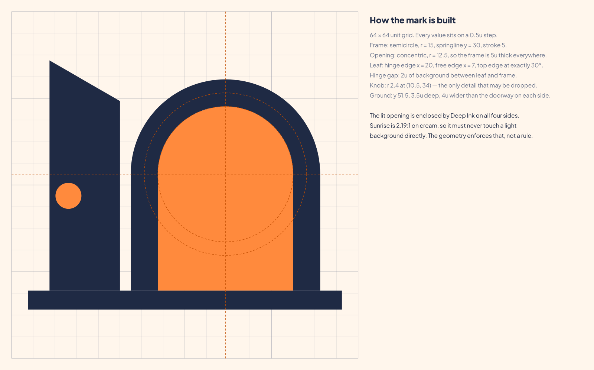
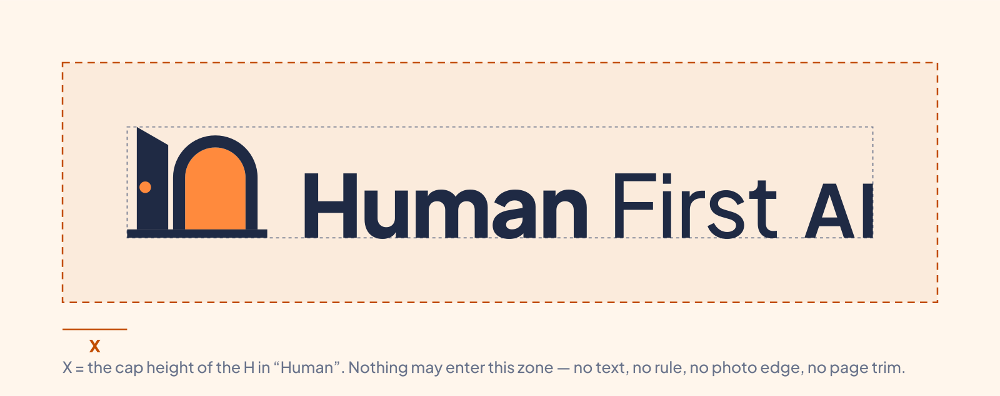
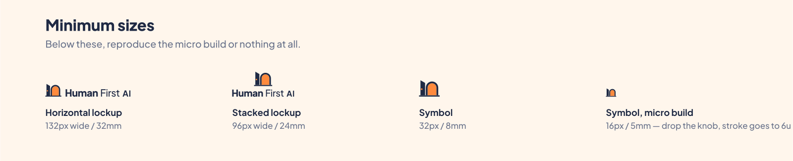
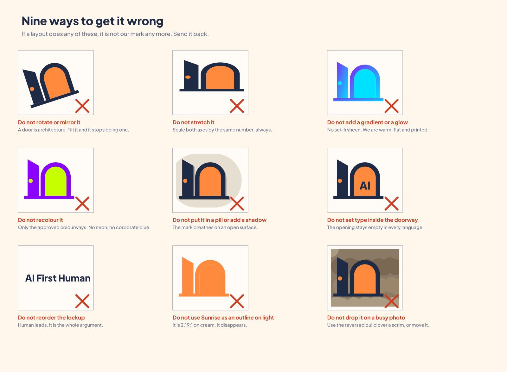

# 03 · Logo

## The Open Door

An arched public doorway, standing on the ground, with the door swung open and warm light in
the opening. A hand on a handle, and a way through.

Doorways are read the same way in every culture this movement works in. The mark needs no
translation, no explanation, and no tagline to make sense.

### What each part is doing

| Part | Why it is there |
|---|---|
| The **arch** | Civic architecture — a library, a school, a market gate. Public, permanent, free to enter. Not a front door to a private house. |
| The **open leaf** | The invitation. It is drawn outside the frame, swung towards you, at exactly 30°. |
| The **handle** | The single detail that makes the shape unmistakably a door rather than a monument. |
| The **lit opening** | Sunrise. Opportunity, warmth, the thing on the other side. |
| The **ground** | It stands on something. The brand is built, not floating. |

## Construction

A 64-unit grid. Every value sits on a 0.5-unit step.

| | |
|---|---|
| Frame | Semicircle, radius 15, springline y 30, stroke 5 |
| Opening | Concentric, radius 12.5, so the frame is 5u thick everywhere |
| Leaf | Hinge edge x 20, free edge x 7, top edge at exactly 30° |
| Hinge gap | 2u of background between leaf and frame |
| Handle | r 2.4 at (10.5, 34) |
| Ground | y 51.5, 3.5u deep, 4u wider than the doorway on each side |

**The one rule that is built in, not written down:** the lit opening is enclosed by Deep Ink on
all four sides. Sunrise is 2.19:1 against cream — well under the 3:1 floor for graphics — so it
is never allowed to meet a light background directly. The geometry enforces that, which is why
the mark passes WCAG 1.4.11 in every colourway without anyone having to remember a rule.

## Lockups

| Lockup | File | Use |
|---|---|---|
| **Horizontal** | `hfai-horizontal-*.svg` | The default. Site headers, letterheads, banners, email. |
| **Stacked** | `hfai-stacked-*.svg` | Social avatars, posters, splash screens, anything square or tall. |
| **Symbol** | `hfai-symbol-*.svg` | Favicons, app icons, stamps, embroidery, pin badges. |
| **Descriptor** | `hfai-descriptor-*.svg` | "GLOBAL MOVEMENT" beneath. Policy papers, formal submissions. |
| **Chapter** | `hfai-chapter-*.svg` | Local use. See [12 Chapters and partners](12-chapters-and-partners.md). |
| **Wordmark** | `hfai-wordmark-*.svg` | Only where the symbol already appears elsewhere on the same surface. |

### Proportions

- Horizontal: symbol height = **1.72 ×** the cap height of "H". Gutter = 0.58 × cap height.
- Stacked: symbol height = **2.04 ×** cap height. Gap = 0.50 × cap height.
- The symbol's ground line sits exactly on the type baseline. The door and the words stand on
  the same ground. That alignment is deliberate — do not nudge it.

### The wordmark

"Human" ExtraBold (800), tracking −0.02em. "First" Medium (500), tracking −0.02em.
"AI" Bold (700) at 0.84 × cap height, tracking +0.03em. **All three in Deep Ink.**

Human leads by weight. AI is smaller and quiet. That is the whole argument of the brand,
expressed as type.

> **v1 correction.** The old wordmark set "AI" in Sunrise — 2.19:1 on cream, which is
> unreadable text inside a logo — and set it at full size in Bold, making the quietest word the
> loudest thing on the page. Both are fixed.

## Colourways

| File suffix | Where |
|---|---|
| `-full` | Default. Deep Ink on Warm Cream. |
| `-reversed` | On Deep Ink. Cream frame, Sunrise opening. |
| `-mono-ink` | One colour. The opening becomes the paper. |
| `-mono-black` | Photocopiers, fax, newsprint, laser etching. |
| `-mono-white` | Over photography with a scrim, dark garments, enamel. |
| `-mono-teal` | Partner contexts where the full colourway clashes. Symbol only. |

Never invent a colourway. If you need one that is not here, see
[13 Governance](13-governance.md).

## Clear space

**X = the cap height of the "H" in "Human".** Nothing enters that zone — no text, no rule, no
photo edge, no page trim, no other logo.

## Minimum sizes

| | Screen | Print |
|---|---|---|
| Horizontal lockup | 132px wide | 32mm wide |
| Stacked lockup | 96px wide | 24mm wide |
| Symbol | 32px | 8mm |
| Symbol, **micro build** | 16px | 5mm |

**The micro build** (`hfai-symbol-micro-*.svg`) is a separate drawing, not the mark scaled
down: stroke goes to 6u, the handle comes off, and the hinge gap widens so it does not fill in.
Use it at 24px and below. Below 16px, use nothing.

## Misuse

If a layout does any of these, it is not our mark any more. Send it back.

1. Do not rotate or mirror it. A door is architecture.
2. Do not stretch it. Scale both axes by the same number.
3. Do not add a gradient, a glow or a shadow.
4. Do not recolour it outside the approved colourways.
5. Do not enclose it in a pill, a badge or a rounded container.
6. Do not set type inside the doorway, in any language.
7. Do not reorder the lockup. Human leads.
8. Do not use Sunrise as an outline or a hairline on a light surface.
9. Do not drop it on a busy photograph. Use the reversed build over a scrim, or move it.

## Right-to-left layouts

The page mirrors: the mark moves to the right, the primary action to the left.
**The symbol itself never mirrors.** A door opens the same way everywhere, and flipping it
would make it a different mark for Arabic and Urdu readers than for everyone else.
