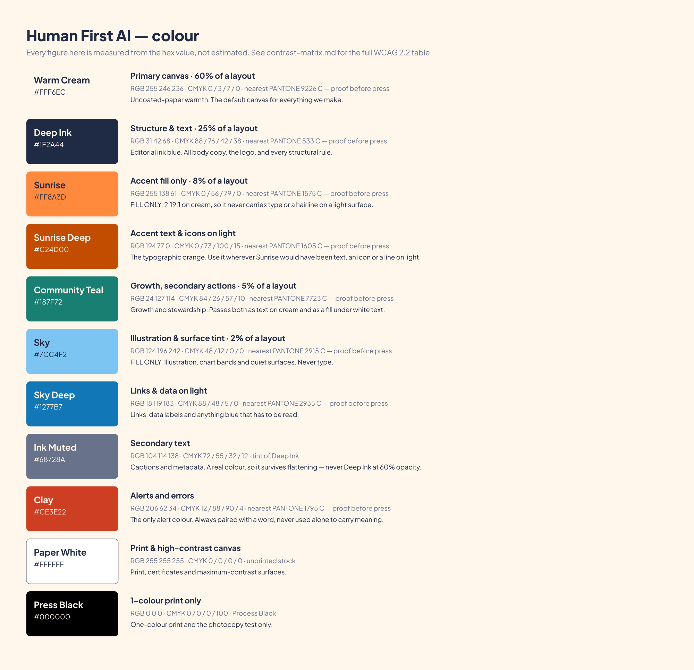

# 04 · Colour



The palette rejects the cyan-and-purple AI aesthetic on purpose. It is drawn from materials:
uncoated paper, fountain-pen ink, sunrise, mineral teal.

## The palette

| | Hex | Role | On cream |
|---|---|---|---|
| **Warm Cream** | `#FFF6EC` | Canvas — 60% of any layout | — |
| **Deep Ink** | `#1F2A44` | Structure and text — 25% | 13.34:1 |
| **Sunrise** | `#FF8A3D` | Accent **fill only** — 8% | 2.19:1 |
| **Sunrise Deep** | `#C24D00` | Accent text, icons and lines on light | 4.51:1 |
| **Community Teal** | `#187F72` | Growth, secondary actions — 5% | 4.55:1 |
| **Sky** | `#7CC4F2` | Surface tint and illustration **only** — 2% | 1.78:1 |
| **Sky Deep** | `#1277B7` | Links and data labels | 4.52:1 |
| **Ink Muted** | `#68728A` | Captions and metadata | 4.50:1 |
| **Clay** | `#CE3E22` | The one alert colour | 4.53:1 |
| **Paper White** | `#FFFFFF` | Print and certificates | — |
| **Press Black** | `#000000` | One-colour print only | — |

Full specification, CMYK and Pantone starting points: [`brand/color/tokens.json`](../brand/color/tokens.json).
Measured contrast for every pair: [`brand/color/contrast-matrix.md`](../brand/color/contrast-matrix.md).

## The two rules that catch most mistakes

**1 · Sunrise and Sky are fills, not inks.** Neither may carry type, a hairline, an icon
stroke or a chart line on a light surface. Both fail the 3:1 floor for graphics. When you want
orange text, use **Sunrise Deep**. When you want blue text, use **Sky Deep**.

**2 · All text on a Sunrise fill is Deep Ink.** White on Sunrise is 2.35:1. It is never
acceptable, at any size, for any reason.

## Distribution

60% Warm Cream · 25% Deep Ink · 8% Sunrise · 5% Community Teal · 2% Sky.

Those are proportions of a finished layout, not a shopping list. A page that is mostly cream
with ink type and one orange thing is correct. A page with five colours fighting is not.

## Semantic tokens

Build with the semantic names, not the raw hexes — that way a palette correction propagates
instead of needing a hunt.

```css
@import url("brand/color/tokens.css");

.card      { background: var(--hf-surface); color: var(--hf-text); }
.card small{ color: var(--hf-text-muted); }
.btn       { background: var(--hf-action-accent-bg); color: var(--hf-action-accent-fg); }
.btn-2     { background: var(--hf-action-secondary-bg); color: var(--hf-action-secondary-fg); }
a          { color: var(--hf-text-link); }
```

Put `data-theme="ink"` on any container sitting on Deep Ink and every token flips to its
reversed value.

Also shipped: `tokens.json`, `tokens.scss`, `tokens.js`, `tailwind.preset.js`, and
`palette.ase` for Adobe and Affinity.

## Colour never carries meaning alone

Roughly one man in twelve has some form of colour-vision deficiency, and a lot of our material
is read in a photocopied handout. Every state that matters is carried by a **word or an icon**
as well as a colour. A red dot is not an error message. "Error: this date has passed" is.

## Print

CMYK values in `tokens.json` are starting points for coated stock. The Pantone references are
**nearest matches to proof against, not specifications** — always pull a physical proof before
a run. Warm Cream in particular is close to unprintable as a spot colour and is usually best
achieved by choosing the right paper rather than laying down ink.

> **v1 correction.** Three pairings in the old matrix were published as passing when they
> failed: white on the old teal (claimed 4.88, actually 4.12), the old teal on cream (claimed
> 4.62, actually 3.85), and Deep Ink on Sunrise (claimed AAA, actually AA). Community Teal was
> darkened from `#1A8C7E` to `#187F72` to clear 4.5:1 in both directions, and Sunrise Deep,
> Sky Deep, Ink Muted and Clay were added so the brand can set accent text at all. Every figure
> in this system is now computed by `tools/build/color.mjs`, not estimated.
