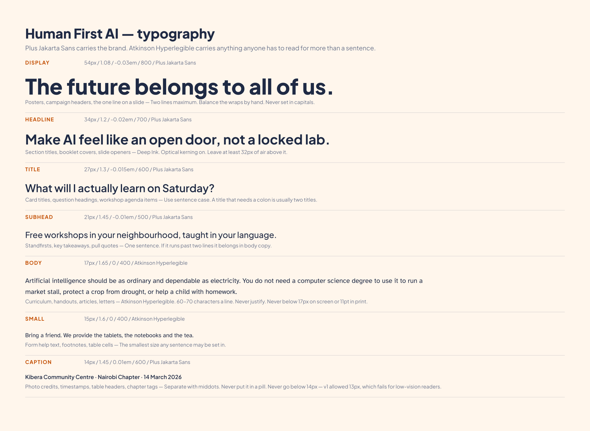

# 05 · Typography

## Two typefaces

**Plus Jakarta Sans** carries the brand — headlines, buttons, labels, the wordmark. Humanist
geometry with open counters. Contemporary without being cold.

**Atkinson Hyperlegible** carries anything anyone has to read for more than a sentence. It was
drawn by the Braille Institute specifically to separate the characters people confuse — 1 l I,
0 O, rn and m. Using it for body copy is not a stylistic choice; it is the single highest-value
accessibility decision in this system.

**Noto Sans** covers everything else: Arabic, Devanagari, CJK, Cyrillic, Greek, Thai.

Both brand faces are SIL Open Font Licence — free to use, free to bundle, free for every chapter
and every partner printer. Files and licences are in [`brand/type/fonts/`](../brand/type/fonts/).

## The scale

One ratio, 1.26, applied the whole way down.

| Step | Size | Line height | Tracking | Weight | Face |
|---|---|---|---|---|---|
| Display | 54px | 1.08 | −0.03em | 800 | Jakarta |
| Headline | 34px | 1.20 | −0.02em | 700 | Jakarta |
| Title | 27px | 1.30 | −0.015em | 600 | Jakarta |
| Subhead | 21px | 1.45 | −0.01em | 500 | Jakarta |
| **Body** | **17px** | **1.65** | 0 | 400 | **Atkinson** |
| Small | 15px | 1.60 | 0 | 400 | Atkinson |
| Caption | 14px | 1.45 | +0.01em | 600 | Jakarta |

Full values, including fluid `clamp()` for the web: [`brand/type/type-scale.json`](../brand/type/type-scale.json)
and [`brand/type/type.css`](../brand/type/type.css).

## Rules

- **Nothing below 14px. Ever.** Not for legal text, not for footnotes, not for captions.
- **Body copy is never below 17px on screen or 11pt in print.** On a community flyer, 14pt.
- **Measure: 60–70 characters.** Longer and people lose the line. `.hf-body` caps at 66ch.
- **Never justify.** Ragged right, always. Justified text on a narrow column opens rivers that
  are genuinely hard to read for dyslexic readers.
- **Never set Display in capitals.** All-caps destroys word shape, which is the thing
  low-vision and dyslexic readers use most.
- **Capitals are allowed in Caption only**, with +0.01em tracking, and only for kickers.
- Sentence case for headings. A heading that needs a colon is usually two headings.

## Across scripts

| Script | Face | Adjustment |
|---|---|---|
| Latin, Greek, Cyrillic | Plus Jakarta Sans / Atkinson | — |
| Arabic, Persian, Urdu | Noto Sans Arabic | 1.1× body size, 1.8 line height for diacritics |
| Devanagari, Bengali, Tamil | Noto Sans (relevant) | 1.05× body size, 1.75 line height |
| Japanese, Chinese, Korean | Noto Sans JP / SC / KR | 1.0×, 1.8 line height, no letterspacing |

**Right-to-left:** the page mirrors — mark right, primary action left. The symbol does not
mirror. Set `dir="rtl"` on the document; `type.css` handles the rest.

> **v1 correction.** The old guidelines showed a Japanese specimen set in Noto Sans JP but never
> loaded the font, so the sample silently rendered in a system fallback. `fonts-cdn.css` now
> loads it. If you are self-hosting, add the subset you actually need —
> do not ship a full CJK face to a 3G connection.

## Performance

Body copy on a rural 3G connection matters more than a perfect first paint.

- Use `fonts.css` (self-hosted) in production. `fonts-cdn.css` is for prototypes and decks.
- One variable file covers every Jakarta weight — one request, not five.
- `font-display: swap` everywhere. Readable fallback text beats invisible text.
- Subset to the scripts the page actually uses.
