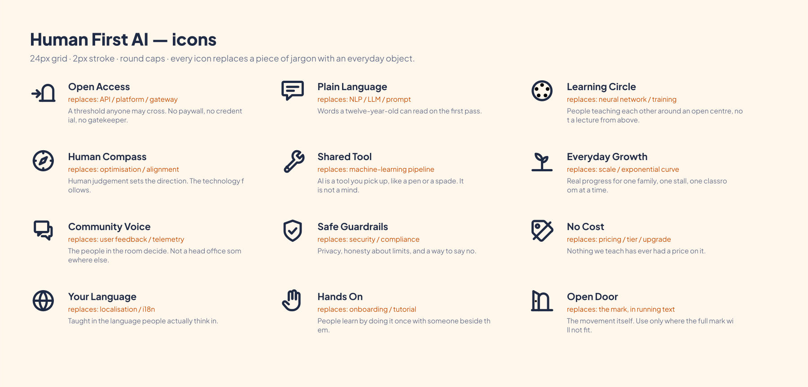

# 06 · Icons



Twelve icons. Each one exists to replace a specific piece of jargon with an everyday object.

24px grid · 2px stroke · round caps and joins · 1.5px safe margin · `currentColor`.

| Icon | Replaces | Means |
|---|---|---|
| Open Access | API, platform, gateway | A threshold anyone may cross |
| Plain Language | NLP, LLM, prompt | Words a twelve-year-old reads first time |
| Learning Circle | neural network, training | People teaching each other, not a lecture |
| Human Compass | optimisation, alignment | Human judgement sets the direction |
| Shared Tool | ML pipeline | A thing you pick up, like a pen |
| Everyday Growth | scale, exponential curve | One family, one stall, one classroom |
| Community Voice | user feedback, telemetry | The people in the room decide |
| Safe Guardrails | security, compliance | Privacy, honest limits, a way to say no |
| No Cost | pricing, tier, upgrade | Nothing we teach has a price |
| Your Language | localisation, i18n | Taught in the language people think in |
| Hands On | onboarding, tutorial | Learning by doing it once, with someone beside you |
| Open Door | — | The movement, where the full mark will not fit |

## Using them

```html
<!-- one sprite, any project -->
<svg class="icon" aria-hidden="true" focusable="false">
  <use href="/brand/icons/hfai-icons.svg#hfai-open-access"></use>
</svg>
```

- Icons inherit `currentColor`. Set the colour on the parent.
- Mark decorative icons `aria-hidden="true"`. If an icon is the only content of a button, give
  the **button** an `aria-label`.
- Minimum 20px on screen. Below that the 2px stroke closes up.
- An icon alone never carries meaning. Pair it with a word, or with an accessible name.

## Drawing a new one

Before you draw: check it is not already here, and check it is not jargon in disguise.

1. 24 × 24 grid, 1.5px safe margin.
2. 2px stroke, round caps and joins, no fills except dots under 2px radius.
3. Build it from the same shapes as the mark — arches, thresholds, the 30° angle.
4. Banned: circuitry, nodes, chips, robots, brains, sparkles, magic wands, rockets.
5. Prove it at 48px, 24px and 16px before proposing it
   (`brand/icons/icons-small-proof.png` shows the format).
6. Propose it via [13 Governance](13-governance.md). Do not just add it to a deck.

> **v1 correction.** The old set listed eight icons whose descriptions did not match the
> drawings — "two overlapping speech dialogues" was a single generic message square, "a
> harmonious ring with people nodes" was a play button in a circle, and several paths were
> lifted unchanged from a general-purpose icon library. These twelve are drawn for this brand
> and each one does what its name says.
