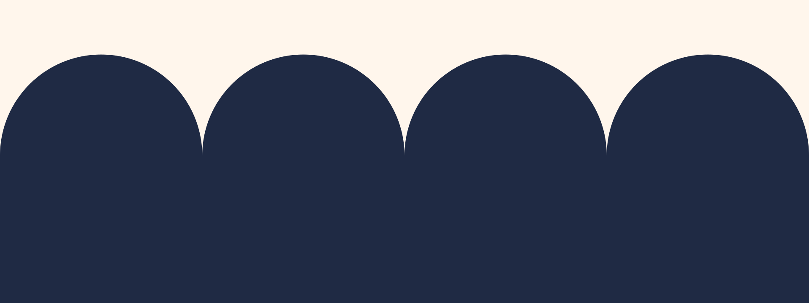

# 08 · Graphic devices

## The Open Threshold

One device. It is the same semicircle that crowns the doorway in the mark — nothing else was
invented for it.



| File | What it does |
|---|---|
| [`arch-window.svg`](../brand/patterns/arch-window.svg) | Clip path. Crops a photograph or holds a pull quote. |
| [`threshold-rule.svg`](../brand/patterns/threshold-rule.svg) | Section divider. The notch is the door leaf's 30°. |
| [`colonnade-*.svg`](../brand/patterns/) | Footer and cover bands. Four arches, seamless left to right. |
| [`tile-arches.svg`](../brand/patterns/tile-arches.svg) | A quiet 96px texture for large flat areas. |

## Rules

- The arch never rotates and never mirrors.
- No gradients. No outline and fill at once.
- On photography, use it as a **crop**, never as an overlay across a face.
- Texture stays under 15% opacity. If you notice it, it is too loud.
- One device per surface. An arch window *and* a colonnade *and* a tile is three ideas.

## Proportion

Width : height-to-springline : radius = 30 : 21.5 : 15 — the mark's own geometry. Keep it, or
the device stops rhyming with the logo and becomes a generic rounded rectangle.

## What we do not have, on purpose

No secondary pattern library. No illustration mascot. No swooshes, no blobs, no mesh
gradients, no dot grids, no isometric cities.

A movement that runs on volunteer-made materials needs a system that cannot be got wrong. One
device, one mark, one palette, one type scale. Everything else is photography and white space.

## Figures in articles

A figure earns its place by showing something the sentence next to it cannot. If it is
decoration, cut it.

**One idea, repeated.** In *Give Yourself the Grace to Be Bad at It* every figure is a ring,
because the article's spine is the crochet magic ring. Three research findings become three
rings in one family rather than three unrelated charts. Find the piece's own shape and let the
figures be variations on it — a page of generic bar charts says nothing about what it is about.

**Rules.**

- **Orthographic.** Looked at from directly above. No perspective, no 3D, no shadows.
- **Halftone dots for depth**, thinning toward the rim. Nothing clips at an edge that way,
  which is why the globe on the showcase page is drawn in dots and not in filled coastlines.
- **Two quantities go on two radii**, never on the same one — an arc drawn over another arc of
  the same radius hides it, and the gap you were trying to show disappears.
- **Every number carries its source** in the caption, as a link. No number is invented to fill
  an arc. If it is estimated, the caption says *about*.
- **The finished state is in the HTML.** Motion is an enhancement, never the content: the
  figure must render complete and correct with JavaScript off and under
  `prefers-reduced-motion`. Animate toward the state that is already there, never away from an
  empty one.
- **`role="img"` and a real `aria-label`** describing the finding, not the drawing.

Add one to an article with a fenced block naming a figure in `tools/lib/figures.mjs`:

````markdown
```figure
hidden-half
```
````

## Missing photographs

An article may reference a photograph the repository does not have. The build does not fail
and does not quietly drop it: the slot renders as a labelled dashed box naming the file and
its alt text, and the build prints the list. That is deliberate. A hole you can see gets
filled; a silent omission ships.

We do not fill the hole with a generated image of a person. See
[07 Photography](07-photography.md).
